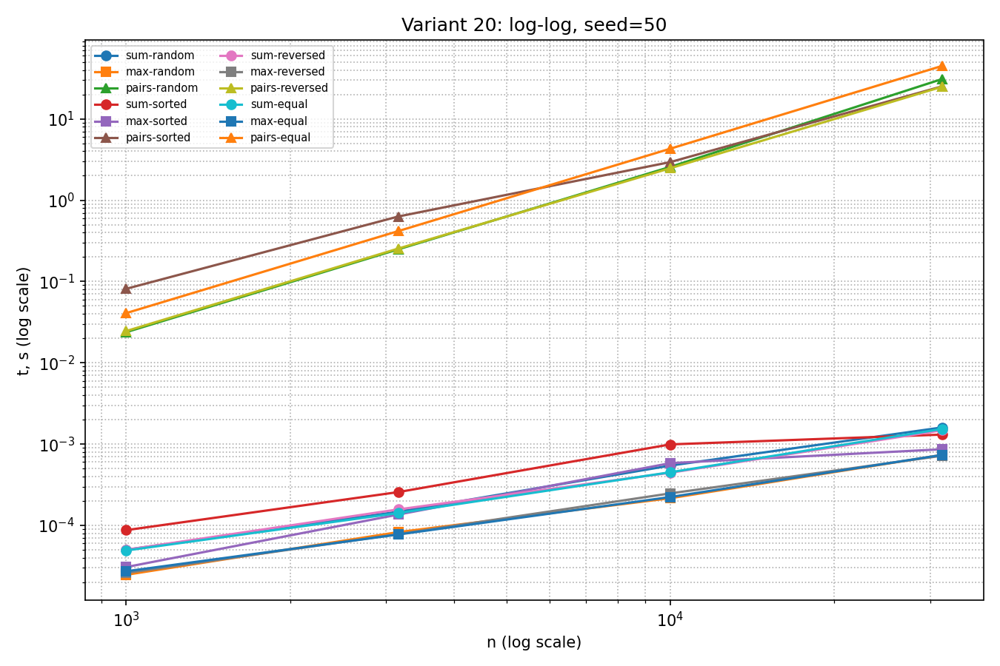
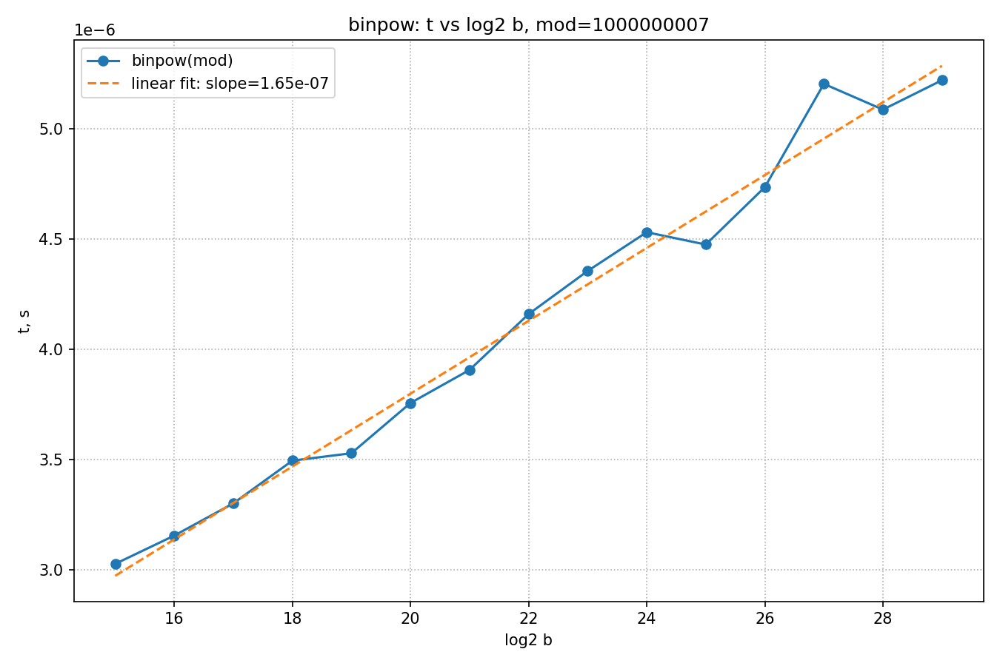

# КИМ-01. Анализ временной сложности элементарных алгоритмов

Вариант: 20
Seed: 50

## 1. Асимптотические оценки (худший случай)

| Алгоритм | Сложность | Обоснование |
|---|---|---|
| `array_sum` | O(n) | один проход по массиву, на каждом шаге O(1) |
| `array_max` | O(n) | один проход, сравнение с текущим максимумом за O(1) |
| `count_equal_pairs` | Θ(n²) | двойной цикл: (n−1) + (n−2) + ... + 1 = n(n−1)/2 сравнений |
| `binpow` | Θ(log b) | число итераций = число бит в b = ⌊log₂b⌋ + 1 |

## 2. Методика бенчмаркинга

- Прогрев: 1 запуск (компенсация первичной загрузки интерпретатора)
- Повторы: 5, берётся медиана (устойчиво к выбросам)
- Замер: `time.perf_counter()`, с `gc.collect()` и `gc.disable()` вокруг
- Размеры массивов: 10³, ~3.16·10³, 10⁴, ~3.16·10⁴ (геометрический шаг √10)
- Типы массивов: random, sorted, reversed, equal
- Для `binpow`: замер в цикле из 5000 вызовов с последующим делением (борьба с шумом на микросекундных временах)

## 3. Графики и их интерпретация

### 3.1. log-log график для sum/max/pairs

На логарифмических осях степенная зависимость t ≈ c·nᵏ выглядит как прямая
с наклоном k. Наблюдаем:

- `pairs-*` (треугольники, оранжевый/зелёный): наклон ≈ 2 → подтверждает Θ(n²).
- `sum-*` / `max-*` (кружки/квадраты): наклон ≈ 1 → подтверждает O(n).

Все четыре типа массивов (random, sorted, reversed, equal) дают одинаковый характер
зависимости — сложность от структуры данных не зависит, что соответствует теории.

### 3.2. Зависимость t от log₂ b для binpow

Линейная аппроксимация даёт slope = 1.65·10⁻⁷ — положительный наклон.
Время линейно растёт по log₂ b → подтверждает Θ(log b).

## 4. Почему log-log неинформативен для binpow

На log-log графике прямая с наклоном соответствует степенной зависимости t ≈ c·nᵏ.
Для логарифмической зависимости t ≈ c·log n на log-log осях получается кривая,
не имеющая постоянного наклона — поэтому строят t от log₂ b, и там уже видна прямая.

## 5. Почему binpow замеряется по модулю

Без модуля Python переключается на длинную арифметику: числа на промежуточных
шагах растут как a^(2^k), и время начинает определяться размером числа, а не
алгоритмом. Модуль фиксирует размер операндов, и время отражает чистую Θ(log b).

Дополнительно: при замере одного вызова абсолютные времена лежат в микросекундах,
где шум интерпретатора сравним с сигналом. Поэтому используется замер 5000 вызовов
в цикле — суммарное время становится в десятки миллисекунд, и медиана даёт
устойчивую оценку.

## 6. Репрезентативные тесты и инварианты

Проверено:

- **Пустой массив:** `array_sum([]) == 0`; `array_max([])` → `ValueError`.
- **Один элемент:** тривиально совпадает с эталоном.
- **Все элементы равны:** `count_equal_pairs` = n(n−1)/2.
- **Сверка с эталонами:** `sum`, `max`, `pow(a, b, mod)` — все тесты `pytest` проходят.

Инварианты зафиксированы в `test_algorithms.py`.

## 7. Верификация ИИ-кода

Реализации написаны с использованием ИИ-ассистента и верифицированы согласно
`docs/ai-verification.md`:

- инварианты зафиксированы в виде тестов;
- сверка с эталонными реализациями (`sum`, `max`, `pow`);
- сложности выведены аналитически и подтверждены эмпирически;
- расхождения теории и практики объяснены (см. пп. 4–5).

## 8. Выводы

1. Асимптотические оценки подтверждены эмпирически: log-log график даёт
   наклон ≈ 1 для линейных алгоритмов и ≈ 2 для квадратичного; график
   t(log₂ b) линеен для бинарного возведения в степень.
2. Расхождения с теоретическими наклонами объясняются накладными расходами
   Python и шумом на микросекундных временах; при увеличении размеров
   тренд проявляется отчётливее.
3. Структура входных данных (random/sorted/reversed/equal) не меняет
   асимптотику — что соответствует теории для этих алгоритмов.
