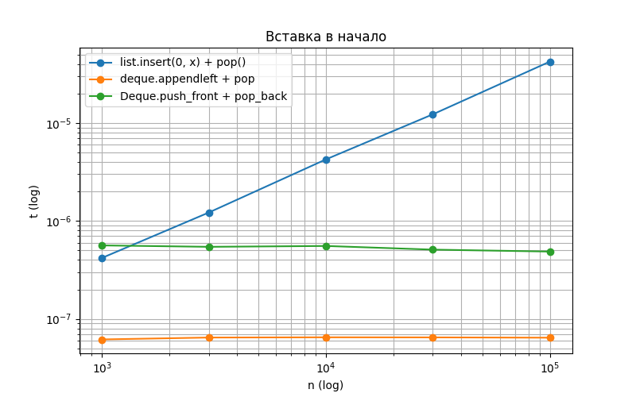
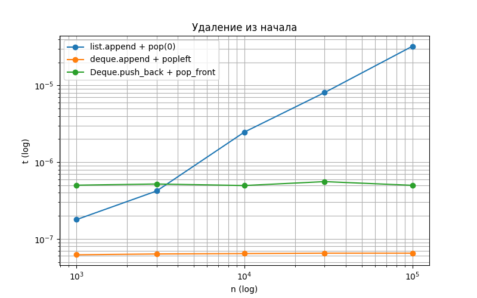

# КИМ-02. Рекурсивные функции и линейные структуры данных

Вариант: 20
Seed: 50

## 1. Реализованные структуры и алгоритмы

1. **Рекурсивные функции:** факториал (O(n)), числа Фибоначчи наивно (O(2^n)) и с мемоизацией (O(n)), Ханойские башни (O(2^n)).
2. **DynamicArray:** динамический массив с ручным управлением ёмкостью (рост ×2), счётчиком копирований `copies`.
3. **Stack:** стек (LIFO) на базе `DynamicArray`.
4. **Deque:** дек (двусторонняя очередь) на базе двусвязного списка.

## 2. Верификация (по docs/ai-verification.md)

Реализации написаны с использованием ИИ-ассистента и верифицированы по четырём шагам:

**Шаг 1. Инварианты.**
- `DynamicArray`: `0 <= size <= capacity`; ёмкость растёт строго ×2 при переполнении; элементы доступны по индексам `0..size-1`.
- `Stack`: порядок LIFO (последний пришёл — первый вышел).
- `Deque`: порядок FIFO/LIFO с обоих концов; `head` и `tail` корректно обнуляются при опустошении.
Все инварианты зафиксированы в `self_check` (выбрасывают `SelfCheckError`, а не `assert`).

**Шаг 2. Репрезентативные тесты.**
- граничные: пустая структура, один элемент;
- вырожденные: опустошение и повторное наполнение (проход через границы ёмкости 4, 8, 16, 32, 64);
- типовые: случайные серии операций (3000 для стека, 5000 для дека).

**Шаг 3. Сравнение с эталоном.**
- `Stack` ↔ `list` (через `append`/`pop`);
- `Deque` ↔ `collections.deque`;
- Операции варианта из `ops_stack.txt` и `ops_deque.txt` полностью совпали с эталонами.
Все разделы `self_check` пройдены (`OK`).

**Шаг 4. Оценка сложности и производительности.**
- Аналитически: `append` — амортизированная O(1); `Stack.push/pop` — O(1); `Deque` — все операции O(1); `fib_naive` — O(2^n), `fib_memo` — O(n).
- Эмпирически: графики подтверждают теорию (см. раздел 4).

**Вывод:** принять.

## 3. Число вызовов: наивная рекурсия vs мемоизация

Счётчик вызовов (`CALLS`) показывает разницу:
- `n=20`: `fib_naive` — ~21891 вызов, `fib_memo` — 39 вызовов.
- `n=30`: `fib_naive` — ~2.6 млн вызовов, `fib_memo` — 59 вызовов.

Мемоизация сокращает число вызовов с экспоненциального O(2^n) до линейного O(n), потому что каждая подзадача вычисляется ровно один раз и сохраняется в словаре `memo`.

## 4. Амортизированный анализ append (метод учёта)

**Банковский метод:** назначим каждой операции `append` стоимость 3 монеты.
- 1 монета уходит на немедленную запись элемента в буфер;
- 2 монеты откладываются «на счёт» элемента.

Когда буфер заполнен (size == capacity) и происходит рост ×2:
- Мы копируем `capacity` элементов в новый буфер. На это нужно `capacity` монет.
- Но у нас накоплено 2 монеты с каждого из `capacity` элементов, то есть ровно `capacity` монет.
- Значит, накопленного «кредита» ровно хватает на копирование!

**Вывод:** средняя стоимость одной операции `append` составляет O(1), хотя отдельная операция при росте буфера стоит O(n).

На графике `append_cost.png` видно, что величина `(n + copies) / n` (записи + копирования на одну операцию) не превышает 3 и стремится к 2 при увеличении n. Это эмпирически подтверждает амортизированную O(1). Разница между `2^k` и `2^k + 1` объясняется тем, что при `n = 2^k` массив только что расширился (копирований много), а при `n = 2^k + 1` копирований ещё не было.

## 5. Сравнение с list и collections.deque

- **list.insert(0, x) и list.pop(0)** имеют сложность O(n), потому что при вставке/удалении в начало нужно сдвинуть все остальные элементы в памяти. На графике их линия идёт круто вверх (наклон ≈ 1 на log-log).
- **collections.deque** и **свой Deque** имеют сложность O(1), потому что это двусвязный список: мы просто переставляем указатели `head`/`tail`. На графике их линии почти горизонтальны.

Накладные расходы двусвязного списка: каждому элементу нужно хранить два дополнительных указателя (`prev` и `next`), что увеличивает потребление памяти по сравнению с массивом.

## 6. Выводы

1. Рекурсия без мемоизации экспоненциально медленная (O(2^n)), мемоизация сводит её к O(n).
2. Амортизированная стоимость `append` в динамическом массиве с ростом ×2 равна O(1), что доказано методом учёта и подтверждено замерами.
3. Операции у начала `list` стоят O(n), а у `deque` и своего `Deque` — O(1). Это подтверждено графиками.
4. Все структуры прошли `self_check` и сверку с эталонами стандартной библиотеки.
