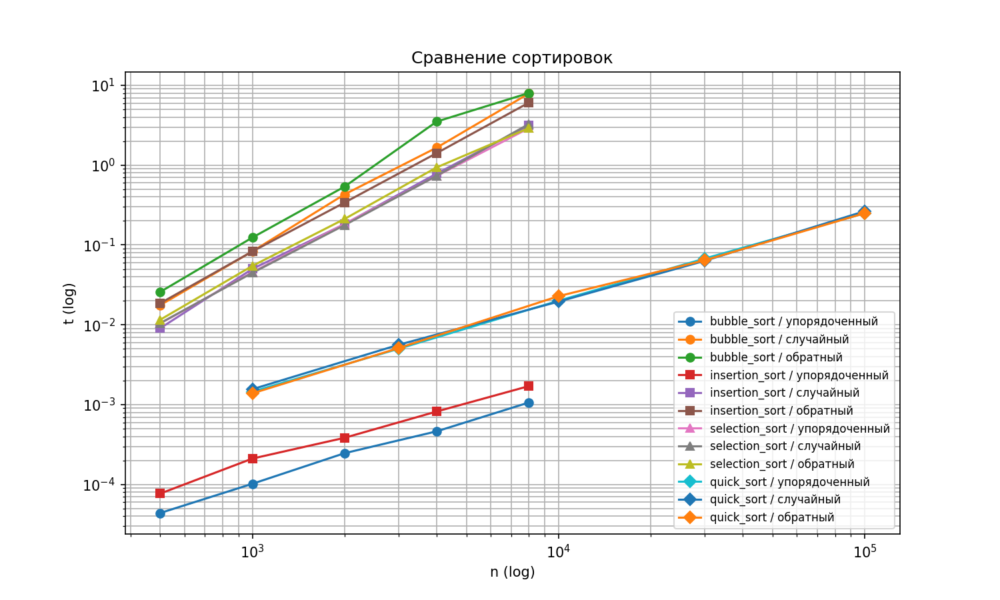

# КИМ-03. Простые сортировки и QuickSort с рандомизацией

Вариант: 20
Seed: 50

## 1. Реализованные алгоритмы

1. **Сортировка пузырьком (bubble_sort)** — O(n²) в среднем/худшем, O(n) в лучшем (с флагом досрочного выхода).
2. **Сортировка вставками (insertion_sort)** — O(n²) в среднем/худшем, O(n) в лучшем (если вход уже отсортирован).
3. **Сортировка выбором (selection_sort)** — Θ(n²) на любом входе.
4. **QuickSort (quick_sort)** — O(n log n) в среднем, O(n²) в худшем. Опорный элемент выбирается случайно (`rng.randrange`).

## 2. Верификация (по docs/ai-verification.md)

Реализации написаны с использованием ИИ-ассистента и верифицированы по четырём шагам:

**Шаг 1. Инварианты.**
- Выход упорядочен по неубыванию (`is_sorted`).
- Выход — перестановка входа (мультимножества совпадают, проверено через `sorted(res) == sorted(a)`).
- У сортировки выбором ровно `n(n-1)/2` сравнений (проверено счётчиком).

**Шаг 2. Репрезентативные тесты.**
- Граничные: пустой массив, один элемент, два элемента.
- Вырожденные: все элементы равны, уже отсортирован, обратно отсортирован.
- Типовые: случайные данные нескольких размеров (seed по варианту).

**Шаг 3. Сравнение с эталоном.**
- Сверка с `sorted()` на 300 случайных входах для каждого алгоритма.
- Все разделы `self_check` пройдены (`OK`).

**Шаг 4. Оценка сложности.**
- Аналитически: O(n²) для простых, O(n log n) для QuickSort.
- Эмпирически: log-log график подтверждает наклоны (см. раздел 4).

**Вывод:** принять.

## 3. Стабильность сортировок

Демонстрация на массиве пар `(ключ, метка)`:
- **Пузырёк** и **вставки** — **стабильны** (сохраняют исходный порядок меток при равных ключах).
- **Выбором** и **QuickSort** — **нестабильны** (могут менять порядок равных элементов).

Стабильность важна, когда сортируем по одному ключу, но хотим сохранить порядок по другому (например, сортировка списка студентов сначала по имени, потом по группе — при стабильной сортировке студенты внутри группы останутся в алфавитном порядке).

## 4. Графики и выводы

- **Простые сортировки (пузырёк, вставки, выбором)** дают наклон ≈ 2 на log-log — это подтверждает O(n²).
- **QuickSort** даёт наклон чуть больше 1 — это ожидаемо для O(n log n) (наклон `log(n log n) / log n = 1 + log(log n) / log n`, что чуть больше 1).
- **Лучший случай вставок:** на упорядоченном массиве вставки работают за O(n) (одно сравнение на элемент, без сдвигов). Пузырёк с флагом тоже даёт O(n) на упорядоченном.
- **Худший случай выбора:** сортировка выбором всегда делает Θ(n²) сравнений, независимо от входа.
- **QuickSort с рандомизацией:** случайный выбор опорного элемента делает маловероятным попадание в худший случай O(n²) (который возникает при детерминированном выборе первого/последнего элемента на уже отсортированном массиве).

## 5. Выводы

1. Простые сортировки имеют квадратичную сложность O(n²), что подтверждено графиками.
2. QuickSort с рандомизацией опорного элемента в среднем работает за O(n log n) и на практике значительно быстрее простых сортировок на больших массивах.
3. Стабильность — важное свойство, которым обладают пузырёк и вставки, но не обладают выбором и QuickSort.
4. Все реализации прошли верификацию: инварианты соблюдены, результаты совпадают с `sorted()`.
